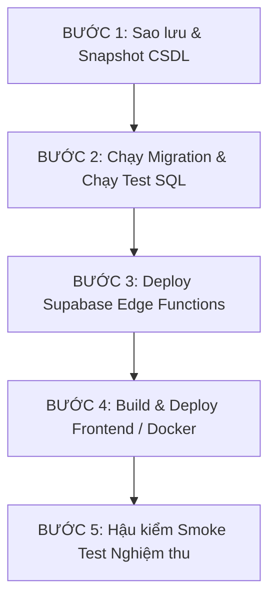

# SỔ TAY VẬN HÀNH & NÂNG CẤP HỆ THỐNG PRODUCTION (PRODUCTION RUNBOOK)
## HỆ THỐNG QUẢN LÝ THU & DỊCH VỤ CÔNG BHXH / BHYT SÔNG MÃ (`qlkh-bhxh-bhyt`)
**Phiên bản phát hành:** 2.1.0-Enterprise  
**Ngày phát hành:** 22/10/2026  
**Mức độ ưu tiên:** Critical (Hoàn tất 4 Giai đoạn: P0 - P1 - P2 - P3)  
**Tiêu chuẩn thực thi:** Nghiêm ngặt từng bước, có kiểm thử hồi quy đối chiếu trước khi Go-live.

---

## 1. TỔNG QUAN NỘI DUNG NÂNG CẤP

Hệ thống đã trải qua đợt tái cấu trúc và vá lỗi toàn diện 4 giai đoạn:

| Giai đoạn | Mã định danh | Hạng mục cốt lõi đã xử lý |
| :--- | :--- | :--- |
| **P0** | Bảo mật & Phân quyền | • Ngăn chặn Path Traversal tại máy chủ tĩnh.<br>• Thu hồi quyền truy cập `anon` trực tiếp trên CSDL; bắt buộc đi qua Edge Function có Cloudflare Turnstile CAPTCHA.<br>• Siết RLS `customers` và `staff` (chống nhân viên đọc/sửa dữ liệu nhân thân của nhau).<br>• Cưỡng chế kiểm tra `is_manager_or_admin()` trên 7 RPC `SECURITY DEFINER`.<br>• Bắt buộc gán danh tính `auth.uid()` trên bảng kiểm toán `auditlogs`. |
| **P1** | Toàn vẹn Dữ liệu & Sổ cái | • Cơ chế khóa giao dịch `pg_advisory_xact_lock` triệt tiêu Race Condition lệch số dư Sổ cái.<br>• Bổ sung Trigger tự động sinh bút toán bù trừ `HOAN_TIEN` khi xóa giao dịch.<br>• Xây dựng hàm `sync_customer_master_data_for_key` chuẩn hóa khách hàng tham gia cả 2 loại hình (`type = 'CẢ HAI'`), tách biệt hạn nộp BHXH/BHYT và chặn thoái thu đè số âm lên `latest_amount`.<br>• Tích hợp đồng bộ Master Data sau khi import Excel hàng loạt. |
| **P2** | Hiệu năng Frontend & State | • Gỡ bỏ 100% lệnh gọi CSDL ngầm trong `useMemo` tại `CRMView.tsx`, triệt tiêu Infinite Realtime Loop.<br>• Nâng cấp Chunked Loading theo khối 1.000 bản ghi tuần tự (`CHUNK_SIZE = 1000`), xóa bỏ hoàn toàn trần cứng 2.500 dòng gây lệch số liệu khi mở rộng quy mô. |
| **P3** | Đóng gói & Vận hành | • Thiết lập Multi-stage `Dockerfile` (Node 20 Alpine Builder + Nginx Alpine Runner siêu nhẹ).<br>• Chuẩn hóa `deploy/docker-compose.yml`, `nginx.conf` với CSP và Cache headers nghiêm ngặt.<br>• Đồng bộ hóa `MASTER_SETUP_ALL_IN_ONE.sql` đồng nhất với chuỗi Migrations.<br>• Xây dựng bộ test SQL tự động 10/10 bài test kiểm chứng. |

---

## 2. CHUẨN BỊ TRƯỚC KHI TRIỂN KHAI (PRE-FLIGHT CHECKLIST)

Trước khi tiến hành nâng cấp trên môi trường Production, Quản trị viên (DBA / DevOps) phải bảo đảm:
- [ ] Thông báo lịch bảo trì dự kiến (cửa sổ bảo trì khuyến nghị: 15 - 30 phút vào ngoài giờ hành chính).
- [ ] Có quyền truy cập **Supabase Dashboard** với quyền Owner / Administrator.
- [ ] Đã cài đặt hoặc có quyền chạy `supabase` CLI (hoặc thao tác qua Supabase SQL Editor).
- [ ] Có quyền truy cập máy chủ Docker / VPS hoặc bảng điều khiển Cloudflare Pages.

---

## 3. QUY TRÌNH TRIỂN KHAI 5 BƯỚC CHUẨN PRODUCTION



### BƯỚC 1: Sao lưu & Snapshot CSDL (Database Backup)

1. Truy cập **Supabase Dashboard** -> Chọn Project -> **Database** -> **Backups**.
2. Nhấn nút **Take backup now** (nếu dùng gói Pro/Enterprise).
3. Hoặc xuất bản sao lưu thủ công qua dòng lệnh máy trạm:
   ```bash
   pg_dump "postgres://postgres:[PASSWORD]@[HOST]:[PORT]/postgres" \
     --clean --if-exists --no-owner --no-privileges \
     -f "backup_pre_upgrade_$(date +%Y%m%d_%H%M%S).sql"
   ```

---

### BƯỚC 2: Nâng cấp Cơ sở Dữ liệu Supabase (Database Migrations)

Tuân thủ nghiêm ngặt một trong hai kịch bản sau:

#### Kịch bản A: Dành cho CSDL đang vận hành (Upgrade in-place)

Mở **Supabase SQL Editor**, tạo New Query và chạy tuần tự từng bước:

##### 2.A.1. Thực thi Migration P0 (Bảo mật & Phân quyền):
1. Mở file [`supabase/migrations/20261022000001_fix_security_p0.sql`](file:///d:/HTML/Gravity/QLBHTN/supabase/migrations/20261022000001_fix_security_p0.sql).
2. Sao chép toàn bộ nội dung dán vào SQL Editor và nhấn **Run**.
3. **Chạy kịch bản kiểm thử bảo mật P0:**
   Mở file [`supabase/tests/test_security_rls_suite.sql`](file:///d:/HTML/Gravity/QLBHTN/supabase/tests/test_security_rls_suite.sql), dán vào SQL Editor và nhấn **Run**.
   > **Kết quả yêu cầu:** Toàn bộ **5/5 bài test** phải trả về trạng thái `PASS`:
   > - `TEST 1: Chặn anon ghi trực tiếp vào bảng records` -> `PASS`
   > - `TEST 2: Chặn anon gọi trực tiếp public_register_customer` -> `PASS`
   > - `TEST 3: Gateway service_role ghi nhận hồ sơ an toàn` -> `PASS`
   > - `TEST 4: Khóa kỳ tài chính chặn ghi/sửa sau khi khóa sổ` -> `PASS`
   > - `TEST 5: Tính bất biến của bảng auditlogs (chặn UPDATE/DELETE/TRUNCATE)` -> `PASS`

##### 2.A.2. Thực thi Migration P1 (Toàn vẹn Sổ cái & Master Data):
1. Mở file [`supabase/migrations/20261022000002_fix_ledger_and_master_data.sql`](file:///d:/HTML/Gravity/QLBHTN/supabase/migrations/20261022000002_fix_ledger_and_master_data.sql).
2. Sao chép toàn bộ nội dung dán vào SQL Editor và nhấn **Run**. Khối lệnh cuối cùng sẽ tự động kích hoạt **Auto-heal** toàn bộ danh bạ khách hàng hiện có.
3. **Chạy kịch bản kiểm thử toàn vẹn P1:**
   Mở file [`supabase/tests/test_ledger_and_master_data_p1.sql`](file:///d:/HTML/Gravity/QLBHTN/supabase/tests/test_ledger_and_master_data_p1.sql), dán vào SQL Editor và nhấn **Run**.
   > **Kết quả yêu cầu:** Toàn bộ **5/5 bài test** phải trả về trạng thái `PASS`:
   > - `TEST 1: Tự động ghi bút toán THU_TIEN khi tạo giao dịch` -> `PASS`
   > - `TEST 2: Khóa xact advisory lock chống race condition sổ cái` -> `PASS`
   > - `TEST 3: Tự động ghi bút toán bù trừ HOAN_TIEN khi xóa giao dịch` -> `PASS`
   > - `TEST 4: Đồng bộ Master Data khách hàng tham gia CẢ HAI (BHXH + BHYT)` -> `PASS`
   > - `TEST 5: Bảo vệ latest_amount không bị đè bởi thoái thu` -> `PASS`

---

#### Kịch bản B: Dành cho CSDL tạo mới hoàn toàn (Fresh Greenfield Deploy)

1. Mở **Supabase SQL Editor**.
2. Sao chép toàn bộ nội dung file [`MASTER_SETUP_ALL_IN_ONE.sql`](file:///d:/HTML/Gravity/QLBHTN/MASTER_SETUP_ALL_IN_ONE.sql) và nhấn **Run**.  
   *(Tệp này đã được tích hợp trọn vẹn toàn bộ cấu trúc bảng, RLS, RPC, Sổ cái tài chính, Bản vá P0 và Bản vá P1).*
3. Chạy lần lượt cả 2 file kiểm thử trong `supabase/tests/` để xác thực hệ số tin cậy **10/10 PASS**.

---

### BƯỚC 3: Cấu hình Bí mật & Triển khai Supabase Edge Functions

1. **Cấu hình Secrets trên máy chủ Supabase:**
   ```bash
   # Nếu dùng Supabase CLI
   supabase link --project-ref <YOUR_PROJECT_ID>

   supabase secrets set APP_ALLOWED_ORIGINS="https://your-domain.vn,https://www.your-domain.vn,https://qlkhbhxh.pages.dev"
   supabase secrets set CLOUDFLARE_TURNSTILE_SECRET_KEY="0x4AAAAAA..."
   supabase secrets set GEMINI_API_KEY="AIzaSy..."
   ```
   *(Hoặc cấu hình trực quan tại Dashboard -> **Edge Functions** -> **Manage Secrets**)*.

2. **Deploy các Edge Functions:**
   ```bash
   # 1. Cổng tiếp nhận dịch vụ công (bắt buộc cờ --no-verify-jwt để khách ngoài Internet gọi được)
   supabase functions deploy public-customer-intake --no-verify-jwt

   # 2. Dịch vụ AI OCR đọc tờ rời BHXH/VssID
   supabase functions deploy gemini-ocr
   ```

---

### BƯỚC 4: Đóng gói & Triển khai Giao diện (Frontend)

Tùy thuộc vào hạ tầng của đại lý, chọn 1 trong 3 phương thức:

#### Cách 1: Triển khai qua Docker Compose (Khuyến nghị cho Máy chủ riêng / VPS)

1. Chuẩn bị file `.env` tại thư mục chứa mã nguồn:
   ```env
   VITE_SUPABASE_URL=https://[YOUR_PROJECT_ID].supabase.co
   VITE_SUPABASE_ANON_KEY=eyJhbGciOi...
   VITE_TURNSTILE_SITE_KEY=0x4AAAAAA...
   ```
2. Khởi chạy container tự động bằng lệnh:
   ```bash
   docker compose up -d --build
   ```
3. Kiểm tra tình trạng container:
   ```bash
   docker compose ps
   # Container hiển thị trạng thái Up (healthy) trên cổng 80:80 là thành công!
   ```

#### Cách 2: Triển khai lên Cloudflare Pages (Serverless Edge Hosting)

1. Đẩy mã nguồn lên nhánh `main` của GitHub Repository:
   ```bash
   git add .
   git commit -m "feat(release): v2.1.0 production ready"
   git push origin main
   ```
2. Trên Cloudflare Pages:
   - Framework preset: `Vite`
   - Build command: `pnpm run build` (hoặc `npm run build`)
   - Build output directory: `dist`
   - Environment variables: Thiết lập `VITE_SUPABASE_URL`, `VITE_SUPABASE_ANON_KEY`, `VITE_TURNSTILE_SITE_KEY`.
3. Cloudflare Pages sẽ tự động kích hoạt Zero-Downtime Deployment.

#### Cách 3: Máy chủ Nginx truyền thống (VPS Linux Ubuntu/Debian)

1. Biên dịch mã nguồn trên máy trạm hoặc VPS:
   ```bash
   pnpm install --frozen-lockfile
   pnpm run build
   ```
2. Sao chép thư mục `dist/` vào thư mục web: `/var/www/newBHXH/dist`.
3. Áp dụng cấu hình Nginx chuẩn từ `deploy/nginx.conf.example` và nạp lại service:
   ```bash
   sudo nginx -t && sudo systemctl reload nginx
   ```

---

### BƯỚC 5: HẬU KIỂM NGHIỆM THU (POST-DEPLOYMENT SMOKE TESTING)

Sau khi deploy hoàn tất, Quản trị viên thực hiện kiểm tra nhanh 5 chức năng then chốt:

1. **Đăng nhập & Phân quyền cán bộ:**
   - Đăng nhập bằng tài khoản Quản trị: Kiểm tra xem được toàn bộ danh sách cán bộ và khách hàng.
   - Đăng nhập bằng tài khoản Nhân viên thu: Kiểm tra chỉ xem được danh sách khách hàng và giao dịch do chính mình phụ trách.
2. **Kiểm tra Hiệu năng & Tải dữ liệu (P2 Validation):**
   - Mở màn hình **Khách hàng (CRM)** và **Tài chính**: Dữ liệu tải trơn tru theo luồng Chunked Loading, không bị giới hạn 2.500 dòng.
   - Mở Console trình duyệt (F12): Xác nhận không xuất hiện vòng lặp re-render hoặc warning lặp gọi RPC liên tục.
3. **Kiểm tra Xuất Biểu mẫu D05-TS (Chuẩn BHXH Việt Nam):**
   - Chọn đúng 2 giao dịch BHXH trên bảng Tài chính -> Nhấn **Mẫu D05-TS (2)**.
   - Mở file Excel xuất ra:
     - ✅ **Chỉ xuất đúng 2 dòng giao dịch đã chọn** (không bị xuất toàn bộ).
     - ✅ **Cột C (Mã số BHXH): Đã hiển thị số CCCD** (đồng bộ theo Đề án 06) với định dạng màu đỏ nổi bật.
4. **Kiểm tra Sổ cái Tài chính & Thoái thu (P1 Validation):**
   - Thử thêm một giao dịch thu tiền -> Sổ cái tự động sinh bút toán `THU_TIEN`.
   - Thử thêm một giao dịch giảm trừ/thoái thu (số tiền âm) -> Master Data khách hàng không bị đổi `latest_amount` thành số âm.
5. **Kiểm tra Cổng Dịch vụ công (Public Intake):**
   - Mở Cổng thông tin công khai (khi chưa đăng nhập), điền mã BHXH/CCCD để tra cứu gia hạn nhanh.
   - Xác nhận có xuất hiện Cloudflare Turnstile CAPTCHA bảo vệ và thông tin trả về đã được che giấu mặt nạ PII (Họ tên viết hoa chữ cái đầu kèm sao, CCCD che 6 số giữa, SĐT che 4 số giữa).

---

## 4. KẾ HOẠCH ROLLBACK DỰ PHÒNG (CONTINGENCY & ROLLBACK)

Trong trường hợp hiếm hoi phát sinh sự cố nghiêm trọng không thể khắc phục ngay:

### 1. Rollback Frontend:
- **Cloudflare Pages:** Truy cập Dashboard -> Chọn bản Deployment thành công trước đó -> Nhấn **Rollback to this deployment** (hiệu lực ngay lập tức).
- **Docker:** Chạy lệnh revert về image phiên bản cũ:
  ```bash
  docker compose down
  # Khởi động lại image tag trước đó hoặc checkout commit cũ và docker compose up -d --build
  ```

### 2. Rollback Cơ sở Dữ liệu:
- Mọi hàm RPC và Trigger trong bản vá đều dùng `CREATE OR REPLACE` nên việc khôi phục về phiên bản trước chỉ cần chạy lại file backup `backup_pre_upgrade_*.sql`:
  ```bash
  psql "postgres://postgres:[PASSWORD]@[HOST]:[PORT]/postgres" -f "backup_pre_upgrade_*.sql"
  ```
- Hoặc phục hồi trực tiếp qua tính năng **Point-in-Time Recovery (PITR)** trên Supabase Dashboard.
